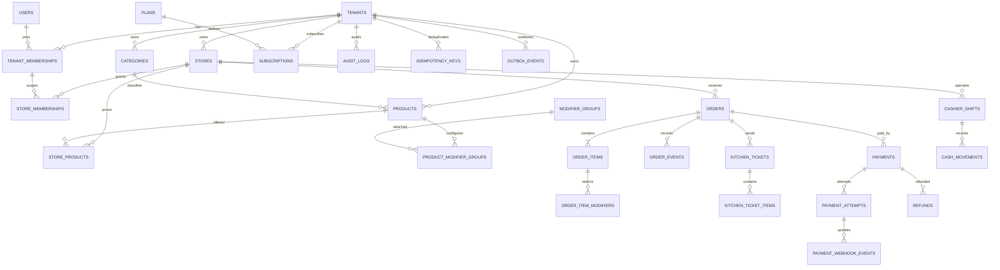

**LARAVEL POS SaaS**

**เอกสารข้อกำหนด ERD และ Database Schema**

สำหรับทีมพัฒนา • MVP ร้านอาหาร / ร้านก๋วยเตี๋ยว • Laravel API + Vue 3 + TypeScript

Version 1.2 | 25 ตุลาคม 2569

*สถานะ: Draft for Engineering Review*

# การควบคุมเอกสาร

| **รายการ** | **รายละเอียด**                                            |
|------------|----------------------------------------------------------|
| ชื่อเอกสาร   | Laravel POS SaaS — ERD & Database Schema Specification   |
| เวอร์ชัน     | 1.2                                                      |
| วันที่        | 25 ตุลาคม 2569 (1.2: บันทึกการตัดสินใจในภาคผนวก B ตาม implementation) |
| สถานะ      | Draft for Engineering Review — ต้องทบทวนก่อนเริ่ม production |
| ผู้ใช้เอกสาร  | Backend, Frontend, QA, DevOps และผู้ดูแลผลิตภัณฑ์              |
| ขอบเขต     | MVP ระบบ POS สำหรับร้านอาหารแบบ Multi-tenant / Multi-store |

# สารบัญโดยย่อ

- 1\. วัตถุประสงค์และขอบเขต MVP

- 2\. สถาปัตยกรรมและหลักการออกแบบ

- 3\. ERD และความสัมพันธ์ของข้อมูล

- 4\. Data dictionary แยกตามโมดูล

- 5\. Constraints, indexes และกฎความถูกต้องของข้อมูล

- 6\. Order, payment และ concurrency rules

- 7\. API และการแบ่งโมดูลใน Laravel

- 8\. Security, audit และ operational requirements

- 9\. Migration plan และลำดับการพัฒนา

- 10\. Acceptance criteria และ test checklist

- ภาคผนวก A: Mermaid ERD และตัวอย่าง migration

# 1. วัตถุประสงค์และขอบเขต MVP

เอกสารนี้กำหนดโครงสร้างฐานข้อมูลและกฎที่ทีมพัฒนาต้องใช้ร่วมกัน เพื่อให้ระบบ POS รองรับร้านอาหารหลายกิจการ (tenant) และหลายสาขา (store) บน Laravel API โดยมี Vue 3 + TypeScript เป็น frontend

## 1.1 ฟังก์ชันที่อยู่ใน MVP

- สร้าง tenant และ store พร้อมตั้งค่า timezone และสถานะการใช้งาน

- บัญชีผู้ใช้ การเป็นสมาชิก tenant/store และ Role-Based Access Control (RBAC)

- หมวดหมู่สินค้า สินค้า ราคาเฉพาะสาขา และตัวเลือกเพิ่มเติม (modifiers)

- เปิดออเดอร์ รับประทานที่ร้าน / กลับบ้าน เพิ่มรายการและปรับจำนวน

- ส่งรายการไปครัวผ่าน kitchen ticket และติดตามสถานะ

- รับชำระเงินสดและ QR ผ่าน Payment Adapter โดยยังไม่ผูก provider รายใด

- จัดการ cashier shift การรับ/จ่ายเงินสด และปิดกะ

- รายงานยอดขายรายวัน/รายสินค้า และ audit log

- SaaS plans/subscriptions สำหรับการจัดการสิทธิ์การใช้งานระดับ tenant

## 1.2 นอกขอบเขต MVP (ทำภายหลัง)

- คลังวัตถุดิบ/สูตรอาหารและการตัด stock แบบละเอียด

- สั่งอาหารผ่าน QR โดยลูกค้า, loyalty/CRM, delivery integrations

- Offline-first synchronization เต็มรูปแบบ

- แยก microservices หรือแยกฐานข้อมูลราย tenant

# 2. สถาปัตยกรรมและหลักการออกแบบ

| **หัวข้อ** | **ข้อกำหนด** |
|----|----|
| Application | Laravel Modular Monolith, REST API versioned ที่ /api/v1 |
| Frontend | Vue 3 + TypeScript; responsive web POS; พิจารณา PWA หลัง MVP |
| Database | PostgreSQL เป็นตัวเลือกหลัก; ใช้ migrations เป็น source of truth |
| Queue / Cache | Redis + Laravel Queue/Horizon; ใช้ outbox สำหรับงานที่ต้องส่งต่ออย่างทนทาน |
| Authentication | Laravel Sanctum; authorization ตรวจ tenant และ store ทุก request |
| Primary key | UUID ทุก entity หลัก; ใช้ Laravel `HasUuids` ซึ่งสร้าง UUID v7 (เรียงตามเวลา — ดีต่อ index locality ตาม §9.1) และยังเป็นคอลัมน์ `uuid` มาตรฐาน |
| Money | จำนวนเงินเก็บเป็น BIGINT หน่วยสตางค์ เช่น 12900 = 129.00 บาท; ห้ามใช้ float/double |
| Time | timestamp เก็บเป็น UTC; business_date คำนวณตาม timezone ของสาขา |
| Tenant model | Shared database/shared schema พร้อม tenant_id และ tenant-aware foreign keys |
| Order snapshot | เก็บชื่อสินค้า ราคา และรายละเอียด modifier ณ เวลาขายไว้ใน order items |
| Consistency | ใช้ DB transaction, row lock และ idempotency ในคำสั่งที่อาจถูกส่งซ้ำ |

## 2.1 ข้อกำหนดสำคัญที่ห้ามละเมิด

- ห้ามเชื่อ tenant_id, store_id, price, discount, tax หรือ total ที่ส่งมาจาก browser โดยไม่ตรวจสอบและคำนวณฝั่ง server

- ห้ามใช้ MAX(order_number)+1 เพื่อสร้างเลขออเดอร์; ต้องใช้ counter row และ lock ภายใน transaction

- ห้ามถือว่าการสร้าง QR สำเร็จเท่ากับการชำระเงินสำเร็จ; ต้องตรวจสอบสถานะจาก provider

- ห้ามลบหรือแก้ไขประวัติการเงินที่สำเร็จแล้วโดยตรง; ใช้ refund/adjustment ที่มี audit trail

- ห้ามอนุญาตให้ foreign key เชื่อมข้อมูลข้าม tenant/store ได้ แม้ API layer จะมี validation แล้วก็ตาม

- การตรวจยอด refund รวมกับยอด payment ต้องทำใน transaction พร้อม lock; CHECK constraint อย่างเดียวไม่พอ

# 3. ERD และความสัมพันธ์ของข้อมูล

ERD ต่อไปนี้แสดงความสัมพันธ์เชิงตรรกะระดับโมดูล โดยบาง composite foreign keys และ index จะถูกระบุเพิ่มใน data dictionary เพื่อบังคับ tenant/store consistency ในฐานข้อมูลจริง.



หมายเหตุ: Mermaid ERD เป็นแผนภาพเชิงสื่อสาร ไม่ได้แสดงทุก column, unique index หรือ composite FK; ให้ใช้ data dictionary และ migration เป็นข้อกำหนดที่บังคับใช้จริง

# 4. Data dictionary แยกตามโมดูล

รูปแบบในตาราง: UUID = UUID primary/foreign key, BIGINT = จำนวนเต็ม 64-bit, JSONB = JSON ที่ PostgreSQL จัดเก็บแบบ binary, timestamptz = timestamp พร้อม timezone. ทุกตารางที่ระบุ tenant_id ต้องใช้ tenant scope ใน query และ policy เว้นแต่มีเหตุผลด้าน security ที่ระบุไว้เป็นพิเศษ.

## 4.1 Tenant, Store, User และ Membership

| **ตาราง** | **คอลัมน์สำคัญ** | **กฎ / Index สำคัญ** |
|----|----|----|
| tenants | id UUID PK; name; slug; status; timezone; created_at; updated_at | slug UNIQUE; status: active/suspended/closed; timezone default Asia/Bangkok |
| stores | id UUID PK; tenant_id UUID FK; code; name; timezone; status; settings JSONB | UNIQUE(tenant_id, code); UNIQUE(tenant_id,id) เพื่อรองรับ composite FK |
| users | id UUID PK; name; email; password; status; email_verified_at; timestamps | email ต้อง normalize เป็น lowercase หรือใช้ CITEXT + UNIQUE; ห้าม log password |
| tenant_memberships | id UUID PK; tenant_id; user_id; status; joined_at | UNIQUE(tenant_id,user_id); UNIQUE(tenant_id,id); user ต้อง active |
| store_memberships | id UUID PK; tenant_id; store_id; user_id; status | FK (tenant_id,store_id) -\> stores; FK (tenant_id,user_id) -\> tenant_memberships |
| roles | id UUID PK; tenant_id nullable สำหรับ system role; name; slug | UNIQUE(tenant_id,slug); กำหนดวิธีจัดการ global role ให้ชัดเจน |
| permissions | id UUID PK; key; description | key UNIQUE; ใช้ permission key แบบคงที่ในโค้ด |
| role_permissions | role_id; permission_id | composite PK(role_id,permission_id) |
| membership_roles | tenant_id; membership_id; role_id; optional store_id | บังคับ role scope ให้ตรง tenant/store; ห้าม role assignment ข้าม tenant |

## 4.2 Catalog และ Modifiers

| **ตาราง** | **คอลัมน์สำคัญ** | **กฎ / Index สำคัญ** |
|----|----|----|
| categories | id; tenant_id; name; sort_order; is_active | ชื่อ/ลำดับตาม tenant; soft delete ได้เมื่อไม่มีข้อขัดแย้งกับประวัติ |
| products | id; tenant_id; category_id nullable; sku; name; description; base_price_satang BIGINT; status | UNIQUE(tenant_id,sku) เมื่อ SKU ไม่ null; base price \>= 0 |
| store_products | tenant_id; store_id; product_id; price_satang; is_available; tax_profile | PK(tenant_id,store_id,product_id); FK composite ไป stores/products; price \>= 0 |
| modifier_groups | id; tenant_id; name; min_select; max_select; is_required; sort_order | min_select \>= 0; max_select \>= min_select |
| modifier_options | id; tenant_id; modifier_group_id; name; price_delta_satang; is_active | ราคาเพิ่ม/ลดเป็นจำนวนเต็ม; อนุญาตค่าติดลบเฉพาะกรณี business rule รองรับ |
| product_modifier_groups | tenant_id; product_id; modifier_group_id; sort_order | composite unique; FK ต้องป้องกันการผูกข้าม tenant |

ข้อกำหนดราคา: ราคา ณ เวลาขายต้องถูกคัดลอกไป order_items และ order_item_modifiers เป็น snapshot; การแก้ชื่อหรือราคาใน catalog ภายหลังต้องไม่เปลี่ยนประวัติออเดอร์

## 4.3 Orders และ Kitchen

| **ตาราง** | **คอลัมน์สำคัญ** | **กฎ / Index สำคัญ** |
|----|----|----|
| orders | id; tenant_id; store_id; business_date DATE; order_number BIGINT; order_type; status; subtotal_satang; discount_satang; tax_satang; total_satang; notes; created_by; timestamps | UNIQUE(store_id,business_date,order_number); composite FK (tenant_id,store_id); totals \>= 0; index (tenant_id,store_id,business_date,status) |
| order_items | id; tenant_id; store_id; order_id; product_id nullable; product_name_snapshot; sku_snapshot; unit_price_satang; quantity; discount_satang; tax_satang; line_total_satang; notes | สินค้าอาจถูกลบจาก catalog จึงเก็บ product_id nullable + snapshot; quantity \> 0 |
| order_item_modifiers | id; order_item_id; modifier_option_id nullable; name_snapshot; price_delta_satang; quantity | snapshot ต้องคงอยู่แม้ modifier ถูกลบ; quantity \> 0 |
| store_order_counters | tenant_id; store_id; business_date; next_number | PK(store_id,business_date); FK (tenant_id,store_id); ใช้ SELECT ... FOR UPDATE |
| order_events | id; tenant_id; store_id; order_id; event_type; from_status; to_status; actor_id; payload JSONB; created_at | append-only; index (order_id,created_at); หลีกเลี่ยงเก็บข้อมูลลับใน payload |
| kitchen_tickets | id; tenant_id; store_id; order_id; revision; status; sent_at; acknowledged_at | UNIQUE(order_id,revision); ส่งซ้ำ/แก้รายการให้สร้าง revision ใหม่ตามกติกา |
| kitchen_ticket_items | id; kitchen_ticket_id; order_item_id; name_snapshot; quantity; modifiers_snapshot JSONB; notes | เก็บ snapshot เพื่อให้ครัวเห็นรายการตามที่ส่ง ณ revision นั้น |

### 4.3.1 Order state และ payment state ต้องแยกกัน

| **Entity** | **สถานะตัวอย่าง** | **คำอธิบาย** |
|----|----|----|
| Order | draft, placed, preparing, ready, served, completed, cancelled | สถานะการทำรายการและการเตรียมอาหาร |
| Payment | pending, processing, succeeded, failed, cancelled, partially_refunded, refunded | สถานะการชำระเงินและคืนเงิน |
| Kitchen ticket | queued, preparing, ready, served, cancelled | สถานะงานครัว (ชุดเดียวกับ D2); acknowledge = queued → preparing; อาจมีหลาย ticket/revision ต่อ order; กดซ้ำสถานะเดิมสำเร็จแบบ idempotent, ย้อนกลับ/ข้ามขั้นที่ไม่อนุญาต = 409 |

## 4.4 Payments, Attempts, Webhooks และ Refunds

| **ตาราง** | **คอลัมน์สำคัญ** | **กฎ / Index สำคัญ** |
|----|----|----|
| payments | id; tenant_id; store_id; order_id; method cash/qr; amount_satang; currency; status; paid_at; created_by | FK composite tenant/store/order; amount \> 0; payment state ไม่เท่ากับ order state |
| payment_attempts | id; tenant_id; store_id; payment_id; attempt_number; provider_code; provider_reference; status; request_payload JSONB; response_payload JSONB; timestamps | UNIQUE(payment_id,attempt_number); ห้ามเก็บ secret/token/ข้อมูลบัตร; จำกัดข้อมูลที่บันทึก |
| payment_webhook_events | id; provider_code; provider_account_key nullable; external_event_id; payload JSONB; signature_verified_at; processed_at; processing_status | unique(provider_code,provider_account_key,external_event_id) ตามขอบเขต ID ของ provider; เก็บ event ซ้ำได้อย่าง idempotent |
| refunds | id; tenant_id; store_id; payment_id; amount_satang; status; reason; provider_reference; created_by; succeeded_at | amount \> 0; ผลรวม refund ที่สำเร็จต้องไม่เกินยอด payment ที่สำเร็จ โดย transaction + lock |

### 4.4.1 Payment Adapter

สร้าง interface ที่ไม่ผูก provider เพื่อให้เลือกผู้ให้บริการภายหลังได้ โดย implementation แรกใช้ Mock/Fake QR provider สำหรับทดสอบ end-to-end

```php
interface PaymentProviderInterface
{
public function createPayment(PaymentRequest $request): PaymentResponse;
public function getPaymentStatus(string $providerReference): ProviderPaymentStatus;
public function verifyWebhook(array $headers, string $rawBody): VerifiedWebhook;
}
```

- การสร้าง QR ให้เปลี่ยน payment เป็น pending/processing เท่านั้น ไม่ใช่ succeeded

- Webhook ต้องตรวจ signature กับ raw body และตรวจ provider account ก่อนนำข้อมูลไปอัปเดต

- ห้ามเชื่อ tenant_id/order_id จาก payload ที่ยังไม่ผ่านการตรวจสอบ; ให้ resolve จาก reference ที่ระบบสร้างหรือข้อมูลที่เชื่อถือได้

- Webhook event ที่เคยประมวลผลแล้วต้องไม่สร้างผลทางการเงินซ้ำ

- การเปลี่ยนสถานะต้องผ่าน service/domain rule และบันทึก event/audit

## 4.5 Cashier shift และ Cash movements

| **ตาราง** | **คอลัมน์สำคัญ** | **กฎ / Index สำคัญ** |
|----|----|----|
| cashier_shifts | id; tenant_id; store_id; cashier_user_id; opening_float_satang; expected_cash_satang; counted_cash_satang; variance_satang; status; opened_at; closed_at | เลือก policy ว่า 1 open shift ต่อ store หรือ ต่อ cashier; บังคับด้วย partial unique index |
| cash_movements | id; tenant_id; store_id; shift_id; movement_type; amount_satang; reason; reference_type; reference_id; created_by; created_at | movement_type: cash_in/cash_out/cash_sale/refund/adjustment; เก็บ append-only |

การปิดกะต้อง lock cashier_shifts row, คำนวณยอดที่คาดหวังจาก cash movements ที่เกี่ยวข้อง และบันทึกยอดนับจริงกับ variance แยกกัน ห้ามแก้ยอดย้อนหลังโดยไม่สร้าง adjustment/audit

## 4.6 SaaS plans และ subscriptions

| **ตาราง** | **คอลัมน์สำคัญ** | **กฎ / Index สำคัญ** |
|----|----|----|
| plans | id; code; name; price_satang; billing_interval; limits JSONB; is_active | code UNIQUE; การเปลี่ยนราคาในอนาคตต้องไม่แก้ invoice/payment เก่า |
| subscriptions | id; tenant_id; plan_id; status; starts_at; ends_at; trial_ends_at; provider_customer_ref nullable | กำหนด policy สำหรับ active/trialing/past_due/cancelled; index tenant/status |
| subscription_payments | id; tenant_id; subscription_id; amount_satang; currency; status; billing_period_start; billing_period_end; plan_price_snapshot_satang; paid_at | เก็บราคา snapshot; แยกจาก payment ของลูกค้าร้านอาหาร |
| tenant_features | tenant_id; feature_key; enabled; limit_value nullable; updated_at | ใช้ override feature/limit เฉพาะ tenant; feature_key เป็นคีย์ที่กำหนดในระบบ |

## 4.7 Audit, Idempotency และ Outbox

| **ตาราง** | **คอลัมน์สำคัญ** | **กฎ / Index สำคัญ** |
|----|----|----|
| audit_logs | id; tenant_id nullable; store_id nullable; actor_user_id nullable; action; subject_type; subject_id; request_id; ip_address; user_agent; metadata JSONB; created_at | append-only; ไม่เก็บ password, access token, payment secrets หรือข้อมูลส่วนบุคคลเกินจำเป็น |
| idempotency_keys | id; tenant_id; store_id nullable; actor_user_id; operation; idempotency_key; request_hash; response_status; response_body JSONB; expires_at | unique scope ต้องกำหนดชัด; ใช้ partial unique index หรือ NULLS NOT DISTINCT ตาม PostgreSQL version |
| outbox_events | id; tenant_id nullable; aggregate_type; aggregate_id; event_type; payload JSONB; occurred_at; published_at; attempts; last_error | บันทึกใน transaction เดียวกับ business change; worker ส่งต่อแบบ retry ได้ |

ข้อควรระวัง: PostgreSQL UNIQUE index ปกติอนุญาตให้มี NULL ซ้ำได้ ดังนั้น idempotency key ที่ store_id เป็น NULL ต้องออกแบบ unique scope ให้ถูกต้อง ห้ามพึ่ง unique(tenant_id, store_id, operation, idempotency_key) เพียงอย่างเดียวโดยไม่พิจารณา NULL

# 5. Constraints, indexes และกฎความถูกต้อง

## 5.1 Tenant-aware foreign keys

ตาราง stores ต้องมี UNIQUE(tenant_id,id) เพื่อให้ตารางลูกอ้างอิงด้วย composite FK ได้ ตัวอย่าง: orders(tenant_id,store_id) REFERENCES stores(tenant_id,id). ตารางลูกที่มี tenant_id/store_id ต้องใช้ composite FK เท่าที่เหมาะสม เพื่อป้องกันข้อมูล tenant A ชี้ไปยัง store/product/order ของ tenant B

```sql
-- ตัวอย่างแนวคิด PostgreSQL
ALTER TABLE stores
ADD CONSTRAINT stores_tenant_id_id_unique UNIQUE (tenant_id, id);
ALTER TABLE orders
ADD CONSTRAINT orders_tenant_store_fk
FOREIGN KEY (tenant_id, store_id)
REFERENCES stores (tenant_id, id);
```

## 5.2 Numeric checks

- ราคาสินค้าและยอดรวมที่ไม่ควรติดลบต้องมี CHECK (... \>= 0)

- quantity ต้องมากกว่า 0; หากรองรับเศษส่วนในอนาคตให้กำหนด numeric precision และ business rule ใหม่ก่อน

- line_total_satang ต้องคำนวณจากราคา จำนวน ส่วนลด และภาษีใน server-side domain service

- CHECK constraint ตรวจได้เฉพาะ row ปัจจุบัน; ห้ามใช้แทน transaction logic ที่ต้องรวมยอดหลาย row

## 5.3 Delete policy

- ห้าม cascade delete ประวัติ orders, payments, refunds, cash movements, audit logs

- ใช้ status/is_active หรือ soft delete สำหรับ catalog ที่ถูกใช้งานในอดีต

- การลบ tenant ควรเป็นกระบวนการปิดใช้งาน/retention workflow ไม่ใช่ลบแบบ cascade ทันที

- กำหนด retention ของ webhook payload และ audit metadata ให้สอดคล้องกับข้อกำหนดความเป็นส่วนตัวและการตรวจสอบ

# 6. Order, payment และ concurrency rules

1.  เริ่ม DB transaction เมื่อสร้าง order พร้อม order_items และต้องตรวจราคา/สิทธิ์จากฐานข้อมูล

2.  สร้างเลข order โดย lock store_order_counters row ด้วย SELECT ... FOR UPDATE แล้ว increment counter

3.  คำนวณ subtotal/discount/tax/total ใน server; client ส่งได้เฉพาะ intent เช่น product_id, quantity, modifier IDs และ note

4.  บันทึก order item snapshots ใน transaction เดียวกับ order

5.  ใช้ idempotency key กับ endpoint สร้างออเดอร์/เริ่ม payment/คืนเงิน เพื่อป้องกัน double-submit

6.  เมื่อรับ webhook ให้ verify signature, บันทึก event แบบ deduplicated, resolve payment, lock payment row, เปลี่ยน state ตาม transition ที่อนุญาต

7.  ก่อนสร้าง refund ให้ lock payment และตรวจผลรวม refund ที่ succeeded + refund ที่ pending (จองยอดไว้) + refund ใหม่ ไม่เกินยอดที่จ่ายสำเร็จ; refund ผ่าน provider ให้สร้าง refund pending ภายใต้ lock แล้วเรียก provider นอก transaction และเก็บ refund ที่ failed ไว้เป็นหลักฐาน ห้าม rollback ทิ้ง

8.  การส่งงานครัวใช้ kitchen ticket revision และ outbox/queue; retry ต้องไม่สร้างงานซ้ำโดยไม่มีการระบุ revision

9.  บันทึก order_events และ audit_logs สำหรับการเปลี่ยนสถานะสำคัญ โดยไม่เก็บ secret ใน payload

# 7. API และการแบ่งโมดูลใน Laravel

## 7.1 โครงสร้างโมดูลที่แนะนำ

```text
app/
  Modules/
    Tenancy/     Models/ Services/ Http/Policies/
    Identity/    Models/ Actions/ Http/
    Catalog/     Models/ Services/ Http/Requests/
    Ordering/    Models/ Actions/ Services/ Http/
    Kitchen/     Models/ Services/ Jobs/ Events/
    Payments/    Contracts/ DTOs/ Providers/ Services/ Jobs/ Http/
    Cashier/     Models/ Services/ Http/
    Reporting/   Queries/ Http/
    Billing/     Models/ Services/ Http/
    Audit/       Models/ Services/
  Support/
    Money/
    Idempotency/
    Outbox/
```

## 7.2 Endpoint groups (ตัวอย่าง MVP)

| **กลุ่ม** | **Endpoint ตัวอย่าง** | **สิ่งที่ต้องตรวจ** |
|----|----|----|
| Session / Identity | POST /api/v1/auth/login; POST /logout; GET /me | authentication, account status, session/token |
| Tenancy / Stores | GET /tenants; GET /stores; POST /stores | membership + permission; ห้ามเลือก tenant โดยไม่ authorize |
| Catalog | GET/POST /products; PATCH /products/{id}; GET /categories | tenant/store scope; ราคาและ availability |
| Orders | POST /orders; GET /orders/{id}; POST /orders/{id}/items; POST /orders/{id}/cancel | idempotency; server totals; state transition |
| Kitchen | POST /orders/{id}/send-to-kitchen; POST /kitchen/tickets/{id}/acknowledge | permission; revision; retry-safe |
| Payments | POST /orders/{id}/payments; GET /payments/{id}; POST /payments/{id}/refunds | provider adapter; idempotency; lock; payment state |
| Cashier | POST /cashier-shifts/open; POST /cashier-shifts/{id}/close; POST /cash-movements | shift ownership/scope; lock; cash reconciliation |
| Reports | GET /reports/sales/daily; GET /reports/sales/products | tenant/store authorization; business timezone; query performance |
| SaaS Admin | GET/POST /plans; POST /subscriptions; GET /tenants/{id}/usage | platform-admin permission; tenant billing isolation |

ข้อกำหนด API: ใช้ Form Request validation, Policy/Gate authorization, API Resource สำหรับ response, rate limit ใน auth/payment, request_id สำหรับ trace และรูปแบบ error response กลางเดียวกัน

# 8. Security, audit และ operational requirements

- Tenant context ต้องมาจาก authenticated membership และผ่าน authorization; ไม่ถือ tenant_id ใน request เป็นหลักฐานสิทธิ์

- ทุก query ที่อ่าน/เขียนข้อมูลธุรกิจต้อง scope tenant_id และ store_id; พิจารณา repository/query scope กลางเพื่อลดการตกหล่น

- ใช้ least privilege กับ database/application credentials; secret ของ payment provider ระดับระบบอยู่ใน secret manager/environment ไม่อยู่ใน DB payload; credentials ของบัญชีรับชำระต่อ tenant เก็บในตาราง payment_accounts แบบเข้ารหัสเท่านั้น (ดูภาคผนวก B7)

- ตรวจ webhook signature ด้วย raw request body; ตรวจ timestamp/replay window หาก provider รองรับ

- ใช้ HTTPS, secure cookies/token handling, CSRF protection ตามรูปแบบ auth, CORS allowlist และ rate limiting

- บันทึก audit สำหรับ login/security events, catalog changes, order cancellation, refund, shift close และ role changes

- มี backup schedule, restore test, migration rollback plan, health checks, structured logs และ alert สำหรับ queue failures

- รายงานต้องใช้ business_date/timezone ของ store; ห้ามใช้ UTC date ตรง ๆ เป็นวันธุรกิจโดยไม่แปลง timezone

# 9. Migration plan และลำดับการพัฒนา

10. Foundation: tenants, stores, users, tenant_memberships, store_memberships

11. Authorization: roles, permissions, role_permissions, membership_roles

12. Catalog: categories, products, store_products, modifier_groups, modifier_options, product_modifier_groups

13. Ordering: store_order_counters, orders, order_items, order_item_modifiers, order_events

14. Kitchen: kitchen_tickets, kitchen_ticket_items

15. Payments: payments, payment_attempts, payment_webhook_events, refunds

16. Cashier: cashier_shifts, cash_movements

17. SaaS billing: plans, subscriptions, subscription_payments, tenant_features

18. Cross-cutting: audit_logs, idempotency_keys, outbox_events

19. เพิ่ม composite foreign keys, CHECK constraints, partial unique indexes และ query indexes หลังตารางต้นทางครบ

20. สร้าง factories/seeders และ automated tests ก่อนเปิดให้ทีม frontend เชื่อม API

## 9.1 แนวทาง UUID และ Laravel

ใช้ Laravel HasUuids กับโมเดลที่มี UUID primary key และ foreignUuid/uuid column ใน migrations. กำหนดชื่อ constraint/index ให้สม่ำเสมอและสั้นพอสำหรับ PostgreSQL. การใช้ UUID v7 อาจพิจารณาภายหลังเพื่อ locality ของ index แต่ MVP ใช้ UUID ที่ Laravel รองรับโดยตรงได้

```php
use Illuminate\Database\Eloquent\Concerns\HasUuids;
use Illuminate\Database\Eloquent\Model;

class Order extends Model
{
    use HasUuids;

    protected $keyType = 'string';
    public $incrementing = false;

    protected $casts = [
        'business_date' => 'date',
        'subtotal_satang' => 'integer',
        'discount_satang' => 'integer',
        'tax_satang' => 'integer',
        'total_satang' => 'integer',
    ];
}
```

# 10. Acceptance criteria และ test checklist

| **หมวด** | **Test ที่ต้องผ่าน** |
|----|----|
| Tenant isolation | ผู้ใช้ tenant A อ่าน/แก้ store, product, order, payment ของ tenant B ไม่ได้; ทดสอบทั้ง API และ service layer |
| Store isolation | สมาชิกที่มีสิทธิ์เฉพาะ store A ไม่สามารถเรียก store B ได้ |
| Pricing | เปลี่ยนราคาสินค้าหลังขายแล้วไม่เปลี่ยน order item snapshot เดิม; client ปลอม total แล้วระบบไม่รับ |
| Order number | request พร้อมกันหลายรายการไม่สร้างเลขซ้ำใน store/business_date เดียวกัน |
| Idempotency | ส่ง request เดิมซ้ำได้ response เดิมหรือผลเดียว โดยไม่สร้าง order/payment ซ้ำ |
| Payment | สร้าง QR แล้วสถานะยัง pending; webhook ที่ invalid signature ไม่เปลี่ยนสถานะ; webhook ซ้ำไม่ทำให้ยอดซ้ำ |
| Refund | ยอด refund ที่ succeeded รวมกันไม่เกินยอดชำระสำเร็จ แม้มี request พร้อมกัน |
| Cashier | ปิด shift พร้อมกันสอง request ไม่เกิดการปิดซ้ำหรือยอด reconcile ผิด |
| Authorization | role/permission ที่ไม่มีสิทธิ์ปฏิเสธ action สำคัญ เช่น refund, cancel, close shift |
| Audit/outbox | เหตุการณ์สำคัญถูกบันทึก; outbox retry แล้วไม่เกิดผลข้างเคียงซ้ำ |
| Time/reporting | รายงานรายวันตรงกับ business timezone ของแต่ละ store และช่วงวันข้ามเที่ยงคืน |
| Migration | สร้างฐานข้อมูลใหม่ได้ตั้งแต่ต้น; rollback ทำตาม dependency order; constraints ถูกติดตั้งครบ |

# ภาคผนวก A — ตัวอย่าง migration สำหรับแนวทาง

ตัวอย่างนี้ใช้สื่อสารแนวทาง ไม่ใช่ migration ทั้งระบบที่นำไป deploy ได้ทันที ทีมต้องเติม composite FK, indexes, constraints, casts และ rollback ให้ครบตาม schema ที่ตกลงกัน

```php
Schema::create('orders', function (Blueprint $table) {
    $table->uuid('id')->primary();
    $table->uuid('tenant_id');
    $table->uuid('store_id');
    $table->date('business_date');
    $table->unsignedBigInteger('order_number');
    $table->string('order_type', 24); // dine_in, takeaway
    $table->string('status', 24)->default('draft');
    $table->unsignedBigInteger('subtotal_satang')->default(0);
    $table->unsignedBigInteger('discount_satang')->default(0);
    $table->unsignedBigInteger('tax_satang')->default(0);
    $table->unsignedBigInteger('total_satang')->default(0);
    $table->uuid('created_by')->nullable();
    $table->text('notes')->nullable();
    $table->timestampsTz();

    $table->unique(['store_id', 'business_date', 'order_number']);
    $table->index(['tenant_id', 'store_id', 'business_date', 'status']);
});

// PostgreSQL CHECK / composite FK อาจเพิ่มผ่าน DB::statement
// หลังจากตาราง parent มี UNIQUE(tenant_id, id) แล้ว
```

# ภาคผนวก B — ประเด็นที่ต้องตัดสินใจก่อน production

ส่วนนี้บันทึกว่า implementation ปัจจุบัน (v1.2) เลือกแนวทางใดไว้แล้ว และข้อใดยังต้องตัดสินใจ

**สถานะ:** ✅ ตัดสินแล้ว (โค้ดและ test บังคับใช้) • ⚠️ ตัดสินสำหรับ MVP แต่ต้องทบทวนก่อนเปิดร้านที่ต่างจากร้านนำร่อง • ❌ ยังไม่ได้ตัดสินใจ / ยังไม่ได้ทำ

## B1. นโยบาย cashier shift — ✅ หนึ่งกะเปิดต่อ store

- เปิดกะได้ครั้งละ 1 กะต่อสาขา บังคับด้วย partial unique index `cashier_shifts_one_open_per_store ON cashier_shifts (store_id) WHERE status = 'open'`; ถ้าเปิดซ้ำจะได้ 409 `shift_already_open`
- ทุก cash payment, cash refund และ cash movement ของสาขาลงกะที่เปิดอยู่นั้น (`CashierService::lockOpenShift`) ไม่ว่าใครเป็นผู้ทำรายการ; ต้องมีกะเปิดก่อนรับเงินสดหรือคืนเงินสด
- ปิดกะ: lock row → คำนวณ expected = opening float + (cash_in + cash_sale) − (cash_out + refund) + adjustment → บันทึก counted และ variance; ปิดซ้ำได้ 409 `shift_not_open`
- ผลที่ตามมา: สาขาที่มีหลายเครื่อง POS ใช้ลิ้นชักเงินร่วมกัน 1 กะ หากร้านต้องการแยกลิ้นชักต่อเครื่อง/ต่อแคชเชียร์ต้องเปลี่ยน index เป็น `(store_id, cashier_user_id)` หรือผูกกับ device และส่ง shift_id ในการชำระเงิน

## B2. ภาษีและส่วนลด — ✅ ราคารวม VAT (inclusive)

- ตัดสินแล้ว: ราคาขายที่ตั้งในเมนูเป็นราคารวม VAT แล้ว ลูกค้าจ่ายตามราคาเมนู ระบบไม่บวกภาษีเพิ่ม
- เปิดใช้ต่อสาขาด้วย `stores.settings.tax_mode`: `none` (ไม่จด VAT — ร้านนำร่อง) หรือ `inclusive`; ถ้าไม่ตั้งจะใช้ค่าเริ่มต้นจาก `POS_TAX_MODE` (ค่าเริ่มต้น `none`); อัตราจาก `POS_VAT_RATE_PERCENT` (ค่าเริ่มต้น 7)
- วิธีคิด: VAT = total × rate / (100 + rate) ปัดเป็นสตางค์ที่ใกล้สุด คิดครั้งเดียวจากยอดทั้งบิลหลังหักส่วนลด (ไม่คิดรายบรรทัด จึงไม่มีเศษปัดสะสม); เก็บที่ `orders.tax_satang` ส่วน `order_items.tax_satang` เป็น 0
- ตัวอย่าง: ยอด 100.00 → VAT 6.54, มูลค่าก่อน VAT 93.46; ลด 10.00 → ยอด 90.00, VAT 5.89, มูลค่าก่อน VAT 84.11
- ใบเสร็จ (`GET /orders/{id}/receipt`) ส่ง `tax_included`, `amount_before_tax` และ `tax` ให้ frontend/เครื่องพิมพ์แสดง
- ลำดับการคิดยอด: subtotal = Σ(ราคาต่อหน่วยรวม modifier × จำนวน) ของรายการ active → หักส่วนลดระดับรายการ → หักส่วนลดระดับออเดอร์ = total (รวม VAT แล้ว)
- ข้อจำกัด: VAT ใช้กับทุกสินค้าในสาขา ยังไม่รองรับสินค้ายกเว้น VAT รายตัว (`store_products.tax_profile` มีไว้แต่ยังไม่ถูกใช้); ยังไม่มี API แก้ settings ของสาขาหลังสร้าง; ถ้าเปลี่ยน tax_mode ขณะมีออเดอร์ค้าง ออเดอร์นั้นจะคิดตามค่าใหม่เมื่อยอดถูกคำนวณซ้ำ; ยังไม่ใช่ใบกำกับภาษีอย่างย่อ (ยังขาดเลขประจำตัวผู้เสียภาษี, เลขทะเบียนเครื่อง POS และเลขที่ใบกำกับที่ต่อเนื่อง)
- ส่วนลดระดับออเดอร์เป็นจำนวนเงิน (satang) ไม่ใช่เปอร์เซ็นต์ ต้องมีสิทธิ์ `orders.discount`, ห้ามเกิน subtotal (422 `discount_exceeds_subtotal`) และถูก cap ไม่ให้เกิน subtotal ใหม่ทุกครั้งที่ยอดถูกคำนวณซ้ำ; ทุกครั้งบันทึก order_event และ audit log
- ส่วนลดระดับรายการมีคอลัมน์ `order_items.discount_satang` แต่ยังไม่มี API ให้ตั้งค่า (เป็น 0 เสมอ)

## B3. เลขออเดอร์และ business_date — ✅ reset รายวันตามวันทำการของสาขา

- เลขออเดอร์เริ่ม 1 ใหม่ทุกวันทำการ แยกต่อสาขา (unique `(store_id, business_date, order_number)`) โดย lock `store_order_counters` ด้วย `SELECT ... FOR UPDATE`; มี test ยิง request พร้อมกันหลายโปรเซสยืนยันว่าเลขไม่ซ้ำ
- `business_date` = วันที่ปัจจุบันตาม `stores.timezone` ณ เวลาสร้างออเดอร์ (ค่าเริ่มต้น `Asia/Bangkok`) และเก็บลง order ถาวร ไม่คำนวณใหม่ภายหลัง; รายงานรายวันใช้ค่านี้
- วันทำการตัดที่เที่ยงคืนตาม timezone ของสาขา ยังไม่รองรับ "day cutoff" (เช่น ร้านที่เปิดเลยเที่ยงคืนแล้วนับเป็นวันเดิม)
- การเปลี่ยน timezone: ตั้งได้ตอนสร้างสาขาเท่านั้น ยังไม่มี API แก้ไข หากเปลี่ยนในฐานข้อมูล ออเดอร์เก่าคง business_date เดิม ออเดอร์ใหม่ใช้ timezone ใหม่ (counter เป็นต่อ business_date จึงไม่ชนกัน แต่วันเปลี่ยนอาจได้ช่วงวันที่สั้น/ยาวกว่าปกติ)

## B4. สถานะและ transition — ✅

| **Entity** | **Transition ที่อนุญาต** |
|----|----|
| Order | `draft` → `placed` (มี ticket queued) → `preparing` → `ready` → `served` คำนวณจากสถานะ kitchen ticket ที่ไม่ถูกยกเลิก; → `completed` เมื่อจ่ายครบพอดี (net paid = total), ทุก ticket served และไม่มีรายการค้างส่งครัว (ข้ามเงื่อนไขครัวเมื่อ `settings.kitchen_enabled = false`); → `cancelled` เฉพาะออเดอร์ที่ยังเปิดและไม่มี payment ค้าง/สำเร็จ (ต้องคืนเงินหรือยกเลิก payment ก่อน) |
| Kitchen ticket | `queued` → `preparing` (acknowledge); `queued`/`preparing` → `ready`; `ready` → `served`; `queued`/`preparing`/`ready` → `cancelled` (ต้องมีสิทธิ์ `kitchen.void`); ส่ง action เดิมซ้ำเมื่ออยู่สถานะปลายทางแล้วถือว่า idempotent |
| Payment (cash) | สร้างเป็น `succeeded` ทันทีภายใต้กะที่เปิดอยู่ |
| Payment (QR) | `pending` → `processing` (สร้าง QR สำเร็จ) → `succeeded` / `failed` / `cancelled` ผ่าน webhook ที่ verify แล้ว, การ poll สถานะ หรือการยกเลิก; webhook `succeeded` ที่มาหลัง `cancelled`/`failed` ยังรับรู้ยอด (เงินเข้าบัญชีแล้ว); webhook ไม่เปลี่ยนสถานะ payment ที่ refund แล้ว |
| Payment (หลังสำเร็จ) | `succeeded` → `partially_refunded` → `refunded` ผ่าน refund ที่สำเร็จเท่านั้น |
| Refund | `pending` (จองยอด) → `succeeded` หรือ `failed`; refund ที่ failed เก็บไว้เป็นหลักฐานและคืนยอดที่จองไว้ |
| Cashier shift | `open` → `closed` ครั้งเดียว |

## B5. Soft delete, retention และข้อมูล tenant — ❌ บางส่วน

- ✅ Soft delete ใช้กับ catalog เท่านั้น: categories, products, modifier_groups, modifier_options
- ✅ ประวัติการเงินไม่ถูกลบ: FK เป็น `restrictOnDelete` ไม่มี cascade ไปยัง orders, payments, refunds, cash movements, audit logs
- ✅ Idempotency keys หมดอายุใน 24 ชั่วโมง (`POS_IDEMPOTENCY_TTL_HOURS`) และลบทุกชั่วโมงด้วย `idempotency:prune`
- ❌ ยังไม่มี retention สำหรับ `payment_webhook_events` (raw payload), `audit_logs`, `outbox_events` ที่ publish แล้ว, `device_events` และ `print_jobs`; ทุกตารางเก็บถาวร
- ❌ ยังไม่มี workflow ปิด tenant, export ข้อมูล หรือลบข้อมูล tenant (มีเพียงสถานะ `tenants.status = closed`)
- ต้องตัดสินใจ: ระยะเวลาเก็บแต่ละประเภท (หลักฐานทางบัญชี/ภาษีมักต้องเก็บหลายปี แต่ raw webhook payload เก็บสั้นกว่าได้), รูปแบบ export และขั้นตอนลบเมื่อ tenant ขอ

## B6. ขอบเขต unique ของ webhook และ idempotency — ✅

- Webhook event: unique `(provider_code, provider_account_key, external_event_id)` (`payment_webhook_events_dedupe_unique`); `provider_account_key` ใช้ `''` แทน NULL เพื่อให้ unique ทำงานใน PostgreSQL
- Provider reference: unique `(provider_code, provider_reference)` เมื่อไม่เป็น NULL
- Idempotency key: unique `(tenant_id, actor_user_id, operation, idempotency_key)`; key เดิม + body เดิม → ตอบ response เดิม, key เดิม + body ต่าง → 422 `idempotency_key_reused`, กำลังประมวลผลอยู่ → 409 `idempotency_in_progress`; เก็บเฉพาะ response 2xx (error ลบ key ให้ retry ได้)
- ใช้กับ: สร้างออเดอร์, เพิ่มรายการ, ส่งครัว, เริ่มชำระเงิน, คืนเงิน, cash movement

## B7. Provider QR — ✅ Omise และ EasySlip (บัญชีต่อ tenant)

**บัญชีรับชำระ (`payment_accounts`)**
- แต่ละ tenant สร้างบัญชีของตัวเองผ่าน `POST /payment-accounts` (สิทธิ์ `payments.configure`) และแต่ละสาขาเลือกบัญชีด้วย `PUT /stores/{id}/qr-payment-account`; สาขาที่ไม่ได้เลือกใช้ `POS_QR_PROVIDER` (dev/test = mock, production ควรตั้งเป็นค่าว่าง → 422 `qr_not_configured`)
- credentials (Omise secret key, webhook secret, EasySlip API key) เก็บใน DB เข้ารหัสด้วย `APP_KEY` (encrypted cast) ไม่ถูกส่งออกทาง API และไม่ถูกบันทึกใน audit log — เป็นข้อยกเว้นของ §8 เพราะเงินเข้าบัญชีของแต่ละร้าน จึงใช้คีย์ระดับระบบเดียวไม่ได้; การหมุน `APP_KEY` ต้อง re-encrypt ตารางนี้
- webhook URL ต่อบัญชี: `POST /api/v1/webhooks/payments/{provider}/{account_key}` — ระบบเลือก secret จาก account_key แล้ว verify และ resolve payment เฉพาะของบัญชีนั้น (บัญชีหนึ่งแตะ payment ของบัญชีอื่นไม่ได้)

**Omise PromptPay** — เงินเข้าบัญชี Omise ของร้าน
- เรียก API ผ่าน package `soap/laravel-omise` ด้วย `Omise::withKeys()` (public key ใน `settings.public_key`, secret key ใน credentials); URL/timeout/driver ตั้งที่ `config/omise.php`; ตรวจ signature ของ webhook ด้วย `OmiseSignatureValidator::assertValid()` ของ `soap/laravel-omise-webhooks` v2 แบบ standalone (ไม่ใช้ route, ตาราง `webhook_calls` และ job ของ package) เพื่อให้ webhook ทุก provider ผ่าน dedupe ต่อ account ของระบบเดียวกัน
- สร้าง charge `source[type]=promptpay` → QR เป็นรูป (`qr.image_url`); ยอดขั้นต่ำ 20.00 บาท (422 `amount_below_provider_minimum`)
- webhook ตรวจ `Omise-Signature` = HMAC-SHA256 ของ `<Omise-Signature-Timestamp>.<raw body>` ด้วย webhook secret ที่ base64-decode แล้ว, replay window 300 วินาที; poll ด้วย `GET /charges/{id}`
- **คืนเงินผ่าน API ไม่ได้** (Omise: "PromptPay charges cannot be voided or refunded through Omise")

**EasySlip** — ลูกค้าโอน PromptPay เข้าบัญชีร้านโดยตรง ไม่มีค่าธรรมเนียมต่อรายการ (เสียโควตาตรวจสลิป)
- ระบบสร้าง PromptPay QR พร้อมยอดเองจาก `settings.promptpay_id` (`qr.payload`, `qr.requires_slip = true`)
- แคชเชียร์สแกน QR บนสลิปลูกค้า → `POST /payments/{id}/slip` → EasySlip async verify (`matchAccount`, `matchAmount`, `checkDuplicate`, `remark` = provider reference) → ผลมาทาง webhook `X-EasySlip-Signature: sha256=<hmac>`; poll `GET /verify/bank/jobs/{jobId}` ด้วย `GET /payments/{id}?refresh=1`
- สลิปผ่านเมื่อ: ไม่ซ้ำ, ผู้รับตรงกับบัญชีที่ลงทะเบียนไว้ใน dashboard EasySlip ของ tenant และยอดตรง; ไม่ผ่าน → payment ยังเป็น `processing` และแสดง `slip.rejection.reason` ให้สแกนสลิปใหม่
- `transRef` ของสลิปเก็บใน `payment_attempts.provider_transaction_ref` (unique) กันสลิปเดียวจ่ายสองออเดอร์ แม้ EasySlip จะไม่จับว่าซ้ำ
- ไม่มี refund API

**การคืนเงิน QR**
- provider ที่ไม่มี refund API: ร้านโอนคืนลูกค้าเอง แล้วบันทึก `POST /payments/{id}/refunds` พร้อม `refund_method=manual_transfer` และ `transfer_reference`; ถ้าไม่ระบุจะได้ 422 `manual_refund_required`; ใช้ lock และการตรวจยอดเดียวกับ refund อื่น, `refunds.method` = `cash` / `provider` / `manual_transfer`
- ลูกค้าโอนซ้ำหลังจ่ายสำเร็จแล้ว (ธุรกรรมใหม่) → บันทึก audit `payment.extra_transfer_received` ให้ร้านโอนคืน

**ข้อจำกัดที่ยังเหลือ**
- ยังไม่มีงานกระทบยอด (reconciliation) กับ settlement ของ Omise หรือ statement ธนาคาร
- EasySlip `matchAccount` เทียบกับทุกบัญชีใน dashboard ของ tenant — ถ้าสาขาใช้บัญชีธนาคารต่างกัน สลิปที่โอนเข้าบัญชีสาขาอื่นของ tenant เดียวกันจะผ่าน
- ยังไม่ได้ทดสอบกับ sandbox จริงของทั้งสอง provider (test ใช้ HTTP fake ตามเอกสาร API)

# สรุปสำหรับทีม

ให้ใช้เอกสารนี้เป็นฐานสำหรับการ review และแตกงานพัฒนา โดยถือว่า migration, constraints และ automated tests คือข้อบังคับจริง ไม่ใช่เพียง validation ใน UI/API. ลำดับงานที่แนะนำคือ review business rules → finalize schema → full Laravel migrations → models/policies → services/transactions → API → Vue integration → QA/security tests.

สิ่งที่ต้องส่งมอบก่อนเริ่มเชื่อม frontend: migrations ที่รันได้ตั้งแต่ฐานข้อมูลว่าง, ERD ที่ตรงกับ migrations, factories/seeders, tenant isolation tests, order concurrency/idempotency tests และ mock QR provider end-to-end.

# ภาคผนวก C — POS Hardware และ Hardware Integration

ส่วนนี้เพิ่มข้อกำหนดสำหรับอุปกรณ์หน้าร้าน โดยยึดแนวทาง MVP เป็น Responsive Web POS ที่ใช้งานบนคอมพิวเตอร์หรือแท็บเล็ต Android ได้ ไม่เริ่มจาก native application และยังไม่ถือว่าอุปกรณ์ยี่ห้อใดได้รับการรับรองจนกว่าจะทดสอบกับร้านนำร่อง ป.ประทีป อ่าวนาง

## C1. เป้าหมายการออกแบบ

- แยก business logic ของ POS ออกจาก driver/วิธีเชื่อมต่ออุปกรณ์ เพื่อเปลี่ยน printer หรืออุปกรณ์ได้โดยไม่แก้ Order/Payment domain

- เริ่มจากอุปกรณ์ที่ทำงานผ่าน browser หรือ network protocol มาตรฐาน และเพิ่ม local print bridge เฉพาะเมื่อจำเป็น

- การพิมพ์ซ้ำต้องไม่สร้าง Order หรือ Kitchen Ticket ใหม่

- หากเครื่องพิมพ์/จอครัวออฟไลน์ ต้องเห็นสถานะความผิดพลาดและมีวิธี retry ที่ปลอดภัย

- การจ่ายเงิน QR ต้องแยกจากการแสดง QR และแยกจากการยืนยันเงินเข้า

## C2. อุปกรณ์ใน MVP

| **อุปกรณ์** | **บทบาท** | **แนวทาง MVP** | **ข้อควรระวัง** |
|----|----|----|----|
| POS terminal | รับออเดอร์/ชำระเงิน/จัดการกะ | PC หรือ Android tablet ผ่าน responsive web; browser รุ่นปัจจุบัน | ทดสอบขนาดจอ, touch, keyboard และความเสถียรเครือข่าย |
| Receipt printer | พิมพ์ใบเสร็จลูกค้า | แนะนำ network thermal printer ที่รองรับ ESC/POS; ทดลอง browser print หรือ local bridge | Browser print อาจเปิด print dialog; direct ESC/POS มักต้องมี bridge/agent |
| Kitchen printer | พิมพ์ใบสั่งอาหารสำรอง | Network thermal printer แยกจาก receipt printer ถ้าครัวต้องใช้กระดาษ | ควรแยกคิวงานพิมพ์ครัวจากใบเสร็จ |
| Kitchen display | แสดงคิวงานครัวและเปลี่ยนสถานะ | Android tablet/จอสัมผัส/PC เปิด Kitchen Dashboard ผ่าน browser | ต้องมีเสียงแจ้งเตือน, ตัวอักษรอ่านง่าย และป้องกันจอดับ |
| Cash drawer | เก็บเงินสด | ต่อผ่าน receipt printer ที่รองรับ drawer kick หรือใช้ชุดที่ผ่านการทดสอบ | ไม่ควร assume ว่าควบคุม drawer ได้จาก browser โดยตรง |
| QR display | แสดง QR ให้ลูกค้าสแกน | แสดง QR บน POS screen หรือจอแยกที่รับข้อมูลจาก POS | QR ที่แสดงไม่ใช่หลักฐานว่าชำระสำเร็จ |
| Barcode scanner | สแกนสินค้า/รหัสภายใน (ถ้ามี) | USB/Bluetooth แบบ keyboard wedge; ไม่จำเป็นต่อ MVP ร้านก๋วยเตี๋ยว | ตรวจว่ามีการส่ง Enter suffix และโฟกัส input ถูกต้อง |

## C3. รูปแบบการเชื่อมต่อเครื่องพิมพ์

| **วิธี** | **ข้อดี** | **ข้อจำกัด** | **ใช้เมื่อ** |
|----|----|----|----|
| Browser print | ติดตั้งง่าย; ไม่ต้องมี service เพิ่ม | อาจมี print dialog; ควบคุม cut/drawer/format ได้จำกัด | พิมพ์ใบเสร็จมาตรฐาน และยอมรับขั้นตอนผู้ใช้ได้ |
| Network ESC/POS ผ่าน local print bridge | พิมพ์อัตโนมัติ, สั่งตัดกระดาษ/เปิดลิ้นชักได้ในรุ่นที่รองรับ | ต้องติดตั้ง/ดูแล bridge; ต้องออกแบบ authentication และ network security | ต้องการ one-click/automatic printing ในร้าน |
| Vendor SDK/Cloud printing | อาจมี device management และการรองรับเฉพาะรุ่น | ขึ้นกับ vendor, ค่าใช้จ่าย, network และข้อจำกัด API | เมื่อเลือกผู้ผลิตที่มี SDK/cloud service เหมาะสม |

ข้อเสนอสำหรับ MVP: เริ่มทดสอบ Browser print เพื่อพิสูจน์ workflow และต้นทุนจริงก่อน หากต้องการพิมพ์ครัวอัตโนมัติหรือเปิดลิ้นชักเงิน ให้ทำ Hardware Adapter/Local Print Bridge เป็น component แยก ไม่ให้ Laravel API เปิด TCP ไปยัง printer โดยตรงจาก public internet

## C4. Hardware Integration Architecture

```text
            Vue POS / Kitchen Dashboard
                        |
                        | HTTPS REST API
                        v
         Laravel API (Orders, Kitchen, Payments)
                        |
                        +--> Transaction + kitchen_tickets + outbox_events
                        |
                        v
                   Queue Worker
                        |
           +------------+------------+
           |                         |
   Kitchen Dashboard          Print Job Queue
           |                         |
      Polling MVP          Print Adapter / Bridge
                                     |
                              Network Printer
```

ข้อกำหนดด้านความปลอดภัย: Local Print Bridge ต้องรับคำสั่งจากระบบที่ยืนยันตัวตนได้เท่านั้น จำกัดปลายทาง printer เป็น allowlist, ห้ามเปิด port สาธารณะ, ห้ามให้ browser ส่ง raw printer commands โดยไม่มี validation และบันทึกสถานะ job/ข้อผิดพลาด

## C5. ตาราง/ข้อมูลเสริมที่แนะนำ

| **ตาราง** | **คอลัมน์หลัก** | **วัตถุประสงค์** |
|----|----|----|
| store_devices | id UUID; tenant_id; store_id; device_code; name; device_type; connection_type; status; last_seen_at; config JSONB | ทะเบียนอุปกรณ์ของแต่ละสาขา; config ห้ามเก็บ secret แบบ plaintext |
| print_jobs | id UUID; tenant_id; store_id; document_type; source_type; source_id; printer_device_id nullable; status; attempts; idempotency_key; requested_at; printed_at; last_error | ติดตามงานพิมพ์และ retry; document_type เช่น receipt/kitchen_ticket |
| device_events | id UUID; tenant_id; store_id; device_id; event_type; payload JSONB; occurred_at | เก็บ online/offline, printer error, bridge heartbeat และ diagnostic แบบจำกัดข้อมูล |

ควรมี unique key สำหรับ print job ตาม business operation/document revision เพื่อกันการสร้าง job ซ้ำโดยไม่ตั้งใจ แต่ต้องอนุญาต reprint แบบ explicit โดยบันทึกว่าเป็นการพิมพ์ซ้ำและผู้ร้องขอ

## C6. เกณฑ์ทดสอบ Hardware ก่อนเปิดร้าน

- พิมพ์ใบเสร็จภาษาไทย/ตัวเลข/ยอดเงินได้ถูกต้อง และ layout อ่านง่าย

- การพิมพ์ซ้ำไม่ทำให้สร้าง order/payment ซ้ำ และมีป้ายหรือ metadata ระบุ reprint

- ถอดสาย/ปิดเครื่องพิมพ์ระหว่างงานแล้วระบบแสดง failed/pending และ retry ได้

- ทดสอบ network หลุดและกลับมาใช้งาน โดยไม่สูญเสีย order ที่ commit แล้ว

- ทดสอบลิ้นชักเงินสดเฉพาะรุ่นและวิธีเชื่อมต่อจริง ไม่ assume จากชื่อรุ่น

- ตรวจสิทธิ์การสั่งพิมพ์และการเปิดลิ้นชัก; บันทึก audit เมื่อเป็นการกระทำที่มีผลทางการเงิน

- ทดสอบการใช้จอสัมผัสในสภาพแวดล้อมร้านจริง ทั้งความสว่าง ระยะมองเห็น และการทำงานต่อเนื่อง

# ภาคผนวก D — Kitchen Dashboard / Kitchen Display System (KDS)

Kitchen Dashboard เป็น client แยกจาก POS แต่ใช้ Laravel API และฐานข้อมูลชุดเดียวกัน โดยแสดงเฉพาะ Kitchen Ticket ของ tenant/store ที่ผู้ใช้มีสิทธิ์เข้าถึง เป้าหมายคือให้พนักงานครัวเห็นคิวใหม่ได้รวดเร็วและเปลี่ยนสถานะโดยไม่แก้ข้อมูล Order/Payment โดยตรง

## D1. หน้าจอหลัก

| **ส่วนหน้าจอ** | **พฤติกรรมที่ต้องมี** |
|----|----|
| New / Queued | แสดง ticket ใหม่ที่ยังไม่รับงาน; เรียงตามเวลาส่งเข้าครัวและเน้นรายการใหม่ |
| Preparing | แสดง ticket ที่ครัวรับแล้วและกำลังทำ; แสดงเวลาที่ผ่านไป |
| Ready | แสดง ticket ที่พร้อมเสิร์ฟ; มี action ส่งต่อให้พนักงานหน้าร้าน/เปลี่ยนเป็น served ตาม workflow ที่ตกลง |
| Ticket card | เลขออเดอร์, ประเภท dine-in/takeaway, เวลา, รายการ, จำนวน, modifiers, note/ข้อแพ้อาหารถ้ามีการเก็บข้อมูลดังกล่าว |
| Alert | เสียง/ภาพแจ้ง ticket ใหม่และ ticket ที่เกิน threshold; ต้องมีปุ่ม mute และแสดงสถานะการเชื่อมต่อ |
| Filter | กรองตาม station เช่น เครื่องดื่ม/อาหาร/เส้นได้ในอนาคต; MVP อาจเริ่มจากคิวเดียวต่อ store |
| Network status | แสดง last sync/connection state; หากข้อมูล stale ต้องไม่ทำเหมือนเป็น live |

## D2. Workflow และสถานะ

```text
Order submitted
   |
   v
Create/commit Kitchen Ticket + Ticket Items + Outbox Event
   |
   v
Kitchen Dashboard detects ticket (polling in MVP)
   |
   v
Queued --> Acknowledged/Preparing --> Ready --> Served/Closed
   |
   +--> Ticket revision for added/changed items
   +--> Cancel/void follows permission and audit rules
```

สถานะที่ใช้จริงต้องสรุปให้เป็นชุดเดียวใน enum/domain transition; ห้ามให้ frontend เปลี่ยน status ใดก็ได้โดยตรง. การส่งรายการเพิ่มหลังเริ่มทำอาหารควรเป็น revision ใหม่หรือ delta ticket ที่ชัดเจน และต้องแสดงว่าเป็นรายการเพิ่มเพื่อป้องกันครัวทำซ้ำ

## D3. การอัปเดตข้อมูล: Polling ก่อน, Real-time ภายหลัง

| **ทางเลือก** | **แนวทาง** | **เหตุผล** |
|----|----|----|
| Polling — MVP | Dashboard เรียก endpoint เฉพาะ store ทุก 2–5 วินาที โดยใช้ cursor/updated_at และดึงเฉพาะรายการเปลี่ยน | ง่ายต่อการ deploy และ debug; เพียงพอสำหรับ pilot หากจำนวน ticket ไม่สูง |
| WebSocket/SSE — Phase 2 | ส่ง event แจ้งว่ามี ticket/status เปลี่ยน แล้ว client fetch รายละเอียดล่าสุดจาก API | ลด latency/traffic เมื่อมีหลายจอหรือปริมาณออเดอร์สูง |
| Fallback | เมื่อ real-time หลุด ให้ reconnect และ full/delta sync; แสดง last successful sync | ป้องกัน dashboard ค้างโดยไม่แจ้งพนักงาน |

สำหรับ polling ให้ใช้ endpoint แบบ cursor-based เช่น GET /api/v1/kitchen/tickets?status=queued,preparing&updated_after=... หรือ cursor token. ต้องกำหนด retention/การปิด ticket และ full refresh strategy เพื่อไม่ให้ข้อมูลหายเมื่อ client กลับมาออนไลน์

## D4. API สำหรับ Kitchen Dashboard

| **Method / Endpoint** | **หน้าที่** | **กฎสำคัญ** |
|----|----|----|
| GET /api/v1/kitchen/tickets | โหลด ticket ตาม store/status/cursor | authorize store membership; paginate แบบ keyset ตาม (updated_at, id) ด้วย `limit` (สูงสุด 200) + `cursor` และตอบ `has_more`/`next_cursor`; ไม่รับ store_id ที่ผู้ใช้ไม่มีสิทธิ์ |
| GET /api/v1/kitchen/tickets/{id} | โหลดรายละเอียด ticket และ items | ตรวจ tenant/store scope |
| POST /api/v1/kitchen/tickets/{id}/acknowledge | รับงาน/เริ่มทำ | idempotent; transition ที่อนุญาตเท่านั้น |
| POST /api/v1/kitchen/tickets/{id}/ready | แจ้งว่าพร้อม | บันทึก actor/time และ event |
| POST /api/v1/kitchen/tickets/{id}/served | ยืนยันเสิร์ฟ/ปิดงาน | แยกจากการชำระเงิน; ตรวจ permission |
| POST /api/v1/orders/{id}/send-to-kitchen | สร้าง ticket revision | transaction + idempotency + outbox |

## D5. UX และการใช้งานจริงในครัว

- ใช้การ์ดขนาดใหญ่และปุ่มที่กดง่ายบนจอสัมผัส; สีต้องไม่เป็นสัญญาณเดียว ควรมี label/icon ประกอบ

- แสดงเวลารอแบบ elapsed time และตั้ง threshold ได้ต่อ store; อย่าคำนวณจากเวลาของ browser โดยไม่เทียบ server time

- ticket ใหม่ควรมีเสียงแจ้งเตือน แต่ browser อาจต้องได้รับ user gesture ก่อนเล่นเสียง จึงต้องมีขั้นตอนเปิดใช้งานเสียง

- ป้องกันจอดับด้วย kiosk/display settings ของอุปกรณ์ ไม่พึ่ง browser script อย่างเดียว

- เมื่อ ticket ถูกยกเลิกหรือมีรายการเพิ่ม ต้องแสดงการเปลี่ยนแปลงชัดเจนและเก็บ audit

- หากมีหลาย station ในอนาคต ให้แยก routing ของ kitchen ticket ตาม product/station และกำหนดว่า ticket หนึ่งออเดอร์แตกไปหลาย station ได้อย่างไร

## D6. สิทธิ์และความปลอดภัย

- Kitchen user เห็นเฉพาะ store ที่ได้รับมอบหมาย; ห้ามส่ง tenant/store context จาก client แล้วเชื่อทันที

- สิทธิ์ครัวควรเปลี่ยนสถานะ ticket ได้ แต่ไม่ควรแก้ราคา รับชำระเงิน หรือทำ refund

- การ cancel/void ticket หลังเริ่มทำอาหารต้องใช้ permission ที่กำหนดและบันทึกเหตุผล

- ทุก transition สำคัญบันทึก actor_id, timestamp, source/device และ event history

- API ต้องป้องกันการกด action ซ้ำและการเปลี่ยนสถานะย้อนกลับโดยไม่ได้รับอนุญาต

## D7. Acceptance criteria สำหรับ KDS

| **Test** | **ผลที่ต้องได้** |
|----|----|
| Store isolation | จอครัวของ store A ไม่สามารถเห็น ticket ของ store B แม้เรียก API ด้วย ticket UUID ที่รู้มา |
| New ticket latency | Polling MVP แสดง ticket ใหม่ภายในช่วง polling ที่กำหนดเมื่อ network ปกติ |
| Duplicate submission | กดส่งเข้าครัวซ้ำหรือ retry request แล้วไม่เกิด ticket revision ซ้ำโดยไม่ตั้งใจ |
| Revision handling | รายการเพิ่มหลังส่งครัวแสดงเป็น revision/รายการเพิ่มอย่างชัดเจน |
| Concurrent updates | สองจอเปลี่ยนสถานะ ticket พร้อมกันแล้วระบบปฏิเสธ transition ที่ stale หรือขัดแย้ง |
| Network recovery | เมื่อหลุดเครือข่ายแล้วกลับมา จอ sync ข้อมูลล่าสุดและแสดง last sync |
| Audit | สถานะ ticket, ผู้ดำเนินการ และเวลาถูกบันทึกตรวจสอบย้อนหลังได้ |
| Usability | อ่านเลขออเดอร์/รายการ/หมายเหตุได้จากระยะทำงานจริง และปุ่มกดได้บนจอสัมผัส |

# ภาคผนวก E — ขอบเขตที่ต้องยืนยันกับร้านนำร่อง

- จำนวนจุดขาย/เครื่อง POS และจำนวนจอครัวที่ใช้งานพร้อมกัน

- จะพิมพ์ใบเสร็จทุกออเดอร์หรือเฉพาะเมื่อร้องขอ; ต้องพิมพ์ใบสั่งครัวเป็น fallback หรือไม่

- เครื่องพิมพ์ที่เลือกเป็น USB, Ethernet/Wi-Fi หรือ Bluetooth และต้องเปิดลิ้นชักเงินสดหรือไม่

- ครัวเป็นคิวเดียวหรือมีหลาย station (เช่น น้ำ/เส้น/เครื่องเคียง); ใครกด Ready และใครกด Served

- เวลาสูงสุดที่ยอมรับได้ตั้งแต่กดส่งออเดอร์จนปรากฏบน KDS

- นโยบายเมื่ออินเทอร์เน็ตล่ม: MVP แจ้งเตือนและหยุดรับออเดอร์ใหม่บางประเภท หรือยอมให้ทำงาน offline แบบจำกัดใน phase ต่อไป
